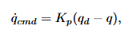
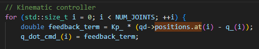
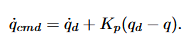
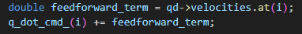

ctrl + shift + v

# 4. Control Architecture:
## Basics:
We have a low level controller joint_controller that reads our joint commands (q_cmd) from a trajectory_publisher.  
Trajectory publisher reads the current joint state from Gazebo and desired trajectory mode from keyboard_node. It then calculates the desired q and qdot from x_d and xdot_d using Inverse Kinematics and publishes them to the joint controller.  
Joint_controller then sends the joint velocity command to the hardware level, which is a Gazebo simulator in this case.  
Xacro files are used to define the hardware level and the robot in Gazebo.  

## Control:
In short, this is a kinematic motion control with velocity input  
Inverse kinematics is used, because the trajectory is in task space, but the controller operates in joint space.  
Kinematic control with feedback control:  
  
  
To mitigate this error, we add a feedforward term to the control law:  
  
  
Feedback reacts to what the robot is actually doing.  
Feedforward predits what the robot should do based on the desired trajectory.  

Without feedback if there are even small amounts of error due to friction, delays, distrubances etc. the error would keep growing.  
Since we have a moving trajectory, feedforward term is neceessary. The information flows directly from the desired trajectory forward to the actuator.